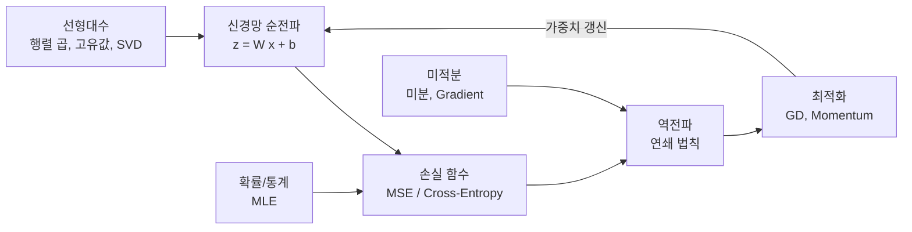
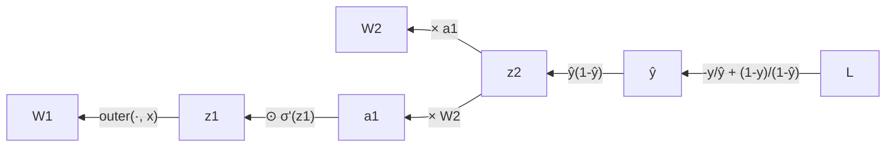

# A2-1 개념 정리 — 선형대수, 미분, 역전파, 경사하강법, 확률로 보는 AI 학습

이 문서는 [A2-1 과제](../subject.md)에 필요한 수학을 처음 배우는 사람 기준으로 설명한다. 공식을 외우는 것보다 **그 공식이 그림에서 무엇을 뜻하는지**, 그리고 **NumPy 코드의 어느 줄이 되는지**를 연결하는 데 초점을 둔다. 작업 순서는 [단계별 실습 가이드](WALKTHROUGH.md)를 본다.

각 절은 다음 순서로 진행한다: 비유 → 정의와 공식 → 손계산 → 과제 연결 → 자주 하는 오해.

## 읽는 순서

| 순서 | 배울 내용 | 이걸 알면 할 수 있는 일 |
| --- | --- | --- |
| 0 | 과제 전체 지도 | 5개 결과물(모듈 3개, 노트북 2개)이 각각 무엇을 증명하는지 설명하기 |
| 1 | 벡터, 행렬, shape | NumPy에서 `@`와 `*`를 구분하고 shape을 예측하기 |
| 2 | 선형 변환(회전, 스케일링, 전단) | 단위 원을 변환해 변환 전후를 겹쳐 그리기 |
| 3 | 행렬식과 면적 | det(A)와 변환 후 면적 비율을 비교해 1% 이내 확인하기 |
| 4 | 고유값, 고유벡터, Power Iteration | 최대 고유값을 직접 계산하고 `np.linalg.eig`와 비교하기 |
| 5 | SVD와 저랭크 근사 | 이미지를 k개 성분으로 압축·복원하기 |
| 6 | 미분과 수치 미분 | 중심차분으로 f'(3)을 구해 1e-4 이내 확인하기 |
| 7 | 편미분, Gradient, 등고선 | Gradient 화살표가 등고선에 수직인 이유 설명하기 |
| 8 | 경사하강법과 학습률 | 학습률에 따라 수렴/진동/발산하는 이유 계산하기 |
| 9 | Momentum | 타원형 함수에서 Momentum이 유리한 이유 설명하기 |
| 10 | 신경망 순전파 | 2층 신경망의 z1, a1, z2, y_pred를 손으로 계산하기 |
| 11 | 연쇄 법칙과 역전파 | 각 가중치의 기울기를 shape과 함께 유도하기 |
| 12 | 확률 분포(PDF, PMF) | 정규분포와 베르누이 분포를 그리고 읽기 |
| 13 | 소프트맥스 | 합이 1인 확률 벡터 만들기, 수치 안정성 처리하기 |
| 14 | 최대우도추정(MLE)과 손실 함수 | MSE와 Cross-Entropy가 왜 그 모양인지 유도하기 |
| 15 | 코드 품질과 재현성 | Docstring, requirements.txt, 시드, outputs/ 저장 규칙 지키기 |
| 부록 | 보너스 개념 미리보기 | Adam, Newton Method, 엔트로피·KL |

1~5는 `src/linear_algebra.py`, 6~7은 `src/calculus.py`, 8~9는 `src/optimizer.py`, 10~11은 `notebooks/backprop_derivation.ipynb`, 12~14는 `notebooks/probability_loss.ipynb`에 대응한다. 순서대로 읽지 않아도 되지만, 10~11(역전파)은 6(미분)을 먼저 읽어야 이해된다.

---

## 0. 과제 전체 지도

**비유**: 신경망 학습은 "안개 낀 산에서 가장 낮은 골짜기 찾기"다.

- 지형(손실 함수)이 어떻게 생겼는지 → **확률/통계**가 알려 준다(왜 MSE, 왜 Cross-Entropy인가).
- 지금 서 있는 곳의 경사 → **미분과 Gradient**로 잰다.
- 경사를 층층이 거슬러 계산 → **역전파(연쇄 법칙)**.
- 한 걸음 내딛는 방법 → **경사하강법, Momentum**.
- 각 층에서 일어나는 계산 자체 → **행렬 곱(선형대수)**.



---

## 1. 벡터, 행렬, shape

**비유**: 벡터는 "화살표" 또는 "숫자 목록", 행렬은 "숫자 표"이자 "공간을 바꾸는 기계"다.

| 대상 | 예 | NumPy shape |
| --- | --- | --- |
| 스칼라 | 0.6071 | `()` |
| 벡터 | x = [1, 0] | `(2,)` |
| 행렬 | W1 = [[0.1, 0.2], [0.3, 0.4]] | `(2, 2)` |
| 점 100개 묶음 | 단위 원 위의 점 | `(2, 100)` 또는 `(100, 2)` |

### 행렬 곱 `@`와 원소별 곱 `*`

- `A @ B`: 행렬 곱. A의 열 수와 B의 행 수가 같아야 한다. `(2,2) @ (2,100) → (2,100)`
- `A * B`: 같은 위치끼리 곱(원소별 곱, Hadamard 곱). shape이 같거나 브로드캐스팅 가능해야 한다.

**손계산**: W1 @ x

$$
\begin{bmatrix}0.1 & 0.2\\ 0.3 & 0.4\end{bmatrix}
\begin{bmatrix}1\\ 0\end{bmatrix}
= \begin{bmatrix}0.1\cdot 1 + 0.2\cdot 0\\ 0.3\cdot 1 + 0.4\cdot 0\end{bmatrix}
= \begin{bmatrix}0.1\\ 0.3\end{bmatrix}
$$

반면 `x @ W1`은 x를 행벡터로 보고 계산해 `[0.1, 0.2]`가 된다. **어느 규약을 쓸지 처음에 정하고 끝까지 지키는 것**이 역전파에서 매우 중요하다. 과제 결과 예시는 `z1 = W1 @ x`(W1의 각 행이 은닉 뉴런 하나) 규약을 쓴다.

### 외적 `np.outer`

`np.outer(a, b)`는 `a[i] * b[j]`를 (i, j) 칸에 넣은 행렬이다. a가 `(2,)`, b가 `(2,)`이면 결과는 `(2, 2)`. 역전파에서 가중치 행렬의 기울기를 만들 때 쓴다(11절).

**자주 하는 오해**: NumPy의 1차원 배열 `(2,)`는 행벡터도 열벡터도 아니다. `W @ x`에서는 열벡터처럼, `x @ W`에서는 행벡터처럼 동작한다. 헷갈리면 매 줄마다 `.shape`을 출력해 본다.

---

## 2. 선형 변환: 행렬은 공간을 바꾸는 기계

**비유**: 고무 시트에 그린 원을 손으로 돌리고(회전), 잡아 늘리고(스케일링), 비스듬히 미는(전단) 것이다. 이때 원점은 움직이지 않고, 직선은 직선으로 남는다. 이런 변형을 **선형 변환**이라 하고, 2차원에서는 2×2 행렬 하나로 표현된다.

### 세 가지 기본 변환

$$
R(\theta)=\begin{bmatrix}\cos\theta & -\sin\theta\\ \sin\theta & \cos\theta\end{bmatrix},\quad
S(s_x, s_y)=\begin{bmatrix}s_x & 0\\ 0 & s_y\end{bmatrix},\quad
Sh(k)=\begin{bmatrix}1 & k\\ 0 & 1\end{bmatrix}
$$

| 변환 | 하는 일 | 단위 원의 결과 |
| --- | --- | --- |
| 회전 R(θ) | 원점 기준 θ만큼 반시계 회전 | 원 그대로(점들의 위치만 돌아감) |
| 스케일링 S(2, 0.5) | 가로 2배, 세로 0.5배 | 가로로 긴 타원 |
| 전단 Sh(k) | 각 점을 y값에 비례해 가로로 밀기 | 기울어진 타원 |

### 손계산

- R(90°) @ [1, 0] = [cos90°, sin90°] = [0, 1] → 오른쪽을 가리키던 화살표가 위를 가리킨다.
- S(2, 0.5) @ [0, 1] = [0, 0.5] → 위쪽 점이 절반 높이로 내려온다.
- Sh(1) @ [0, 1] = [1, 1] → 위쪽 점이 오른쪽으로 1만큼 밀린다. 바닥(y=0)의 점은 움직이지 않는다.

### 단위 원을 변환하는 방법

과제 참고 사항대로 각도를 촘촘히 만들고 좌표를 쌓는다.

```python
theta = np.linspace(0, 2*np.pi, 100)
circle = np.stack([np.cos(theta), np.sin(theta)])   # shape (2, 100): 1행 x, 2행 y
# 변환 후 점들 = 행렬 @ circle   -> 여전히 (2, 100)
```

한 번의 행렬 곱으로 점 100개가 모두 변환된다. 이것이 "신경망의 한 층 = 행렬 곱"과 같은 구조다.

**과제 연결**: 요구사항 4-1의 첫 세 항목. 변환 전후를 **하나의 Figure에 겹쳐** 그린다.

**자주 하는 오해**

- 축 비율을 맞추지 않으면(`ax.set_aspect('equal')` 없이) 원이 타원처럼 보여서 회전 결과를 오해한다.
- 점 배열을 `(100, 2)`로 만들었다면 `circle @ A.T`로 곱해야 같은 결과가 나온다. `circle @ A`는 전치된 변환이 된다.

---

## 3. 행렬식(det)과 면적

**비유**: 고무 시트 위에 1cm² 정사각형을 그려 두고 변환하면, 그 정사각형이 몇 cm²가 되는지가 행렬식이다. 모든 영역이 같은 비율로 커지거나 줄어든다.

### 정의 (2×2)

$$
\det\begin{bmatrix}a & b\\ c & d\end{bmatrix} = ad - bc
$$

- |det| = 면적 배율
- det < 0 이면 뒤집힘(거울상)
- det = 0 이면 평면이 선이나 점으로 찌그러짐(역행렬 없음)

| 변환 | det | 의미 |
| --- | --- | --- |
| R(θ) | cos²θ + sin²θ = 1 | 회전은 면적 불변 |
| S(2, 0.5) | 2 × 0.5 = 1 | 가로로 늘린 만큼 세로로 줄어 면적 불변 |
| Sh(k) | 1·1 - k·0 = 1 | 밀기만 하므로 면적 불변 |
| S(2, 3) | 6 | 면적 6배 |

과제의 세 변환은 모두 det = 1이다. 결과 예시의 "det(S) = 1.0, 면적비 = 1.0"이 이 뜻이다.

### 다각형 면적: 신발끈 공식(Shoelace formula)

변환 후 도형의 면적을 재려면, 원 위의 점들을 꼭짓점으로 하는 다각형의 면적을 구한다. 꼭짓점이 순서대로 $(x_1,y_1), \dots, (x_n,y_n)$일 때

$$
\text{Area} = \frac{1}{2}\left|\sum_{i=1}^{n}\left(x_i y_{i+1} - x_{i+1} y_i\right)\right|,\quad (x_{n+1}, y_{n+1}) = (x_1, y_1)
$$

**손계산**: 단위 정사각형 (0,0), (1,0), (1,1), (0,1)

- 항: (0·0 - 1·0) + (1·1 - 1·0) + (1·1 - 0·1) + (0·0 - 0·1) = 0 + 1 + 1 + 0 = 2
- 면적 = 2 / 2 = 1

S(2, 3)을 적용하면 꼭짓점은 (0,0), (2,0), (2,3), (0,3) → 면적 6 = det. NumPy에서는 "다음 점"을 `np.roll(x, -1)`로 만들어 for 문 없이 계산할 수 있다.

**과제 연결**: 요구사항 4-1 "det(A)와 면적 비율 비교, 오차 1% 이내". 면적 비율 = (변환 후 다각형 면적) / (변환 전 다각형 면적).

**자주 하는 오해**

- 점 100개로 만든 다각형의 면적은 π(≈3.1416)가 아니라 약 3.1395다. 변환 전 면적을 π로 두면 약 0.07% 오차가 생긴다(1% 이내라 통과는 하지만). 변환 전후 모두 다각형 면적으로 재면 선형 변환의 성질 때문에 비율이 det와 거의 정확히 일치한다.
- 오차는 `abs(면적비 - det) / abs(det) * 100`처럼 **상대 오차(%)**로 계산한다.

---

## 4. 고유값, 고유벡터, Power Iteration

### 4.1 개념

**비유**: 고무 시트를 변환할 때 대부분의 화살표는 방향이 틀어진다. 그런데 어떤 특별한 방향의 화살표는 **방향은 그대로, 길이만** 늘거나 준다. 그 방향이 고유벡터, 늘어나는 배율이 고유값이다.

$$
A\mathbf{v} = \lambda \mathbf{v}
$$

**손계산**: A = [[2, 1], [1, 2]]

- 특성방정식: det(A - λI) = (2-λ)² - 1 = 0 → λ = 3 또는 1
- λ = 3의 고유벡터: [1, 1] 방향. 확인: A @ [1, 1] = [3, 3] = 3 × [1, 1]
- λ = 1의 고유벡터: [1, -1] 방향. 확인: A @ [1, -1] = [1, -1]

### 4.2 Power Iteration

**비유**: 아무 방향의 화살표에 A를 계속 곱하면, 가장 크게 늘리는 방향(최대 고유값의 고유벡터) 성분이 점점 지배해서 결국 그 방향으로 정렬된다. 매번 길이를 1로 되돌려(정규화) 숫자가 폭발하지 않게 한다.

알고리즘:

1. 임의의 벡터 $\mathbf{v}_0$에서 시작한다(0벡터 제외).
2. $\mathbf{w} = A\mathbf{v}_k$
3. $\mathbf{v}_{k+1} = \mathbf{w} / \lVert \mathbf{w} \rVert$
4. 고유값 추정: 레일리 몫(Rayleigh quotient) $\lambda_{k+1} = \mathbf{v}_{k+1}^\top A \mathbf{v}_{k+1}$ (단위벡터일 때)
5. $\lambda$ 변화량이 허용오차(tol)보다 작아지거나 최대 반복 수에 닿으면 멈춘다.

**손계산**: A = [[2, 1], [1, 2]], v0 = [1, 0]

| 반복 | A @ v | 정규화한 v | 레일리 몫 λ |
| --- | --- | --- | --- |
| 1 | [2, 1] | [0.8944, 0.4472] | 2.8 |
| 2 | | [0.7809, 0.6247] | 2.9756 |
| 3 | | [0.7328, 0.6805] | 2.9973 |
| 4 | | [0.7158, 0.6983] | 2.9997 |

v는 [0.7071, 0.7071](= [1,1]/√2)로, λ는 3으로 다가간다. 수렴 속도는 두 고유값의 비 |λ2/λ1| = 1/3에 달려 있다. 이 비가 1에 가까울수록 느리다.

**과제 연결**: 요구사항 4-1 "Power Iteration 구현 → `np.linalg.eig`와 비교, 오차 5% 이내". 결과 예시의 행렬 [[4, 1], [1, 3]]의 최대 고유값은 (7 + √5) / 2 ≈ 4.6180이다. 제약 사항상 `np.linalg.eig`는 **검증 코드에서만** 쓰고, 고유값 계산 자체에는 쓰지 않는다.

**자주 하는 오해**

- 고유벡터는 방향만 의미가 있어서 `v`와 `-v`가 같은 답이다. `eig` 결과와 부호가 반대여도 틀린 것이 아니다. 비교할 때 부호를 맞추거나 절댓값으로 비교한다.
- `np.linalg.eig`는 고유값을 크기 순으로 정렬해 주지 않는다. 최대 고유값을 고르려면 직접 최댓값(절댓값 기준)의 인덱스를 찾아야 하고, 고유벡터는 반환 행렬의 **열**(`vecs[:, i]`)이다.
- 시작 벡터가 우연히 최대 고유벡터와 수직이면 수렴하지 않는다. 랜덤 시작 벡터를 쓰면 이 위험이 거의 없다(시드 고정 필수).

---

## 5. SVD와 이미지 압축

### 5.1 개념

**비유**: 그림을 "큰 붓질 몇 번 + 세밀한 붓질 여러 번"으로 나눠 그린다고 생각한다. 큰 붓질 몇 번만으로도 대략의 모습이 나온다. SVD는 행렬을 중요도 순으로 정렬된 "붓질(랭크 1 행렬)"들의 합으로 쪼갠다.

$$
A = U \Sigma V^\top = \sum_{i=1}^{r} \sigma_i \mathbf{u}_i \mathbf{v}_i^\top
$$

| 기호 | shape (A가 m×n, `full_matrices=False`일 때) | 의미 |
| --- | --- | --- |
| U | (m, r) | 왼쪽 특이벡터(열들이 서로 수직) |
| Σ | 대각에 σ₁ ≥ σ₂ ≥ … ≥ 0 | 특이값, 각 성분의 중요도 |
| Vᵀ | (r, n) | 오른쪽 특이벡터 |

여기서 r = min(m, n).

### 5.2 저랭크 근사(rank-k approximation)

앞의 k개 성분만 남긴다.

$$
A_k = \sum_{i=1}^{k} \sigma_i \mathbf{u}_i \mathbf{v}_i^\top = U_{:, :k}\, \Sigma_{:k}\, V^\top_{:k, :}
$$

Eckart–Young 정리에 따르면 이것이 "랭크 k인 행렬 중 A와 가장 가까운 행렬"이다.

**저장량 손계산** (64×64 흑백 이미지)

- 원본: 64 × 64 = 4,096개 숫자
- 랭크 k: U의 k열(64k) + σ k개 + Vᵀ의 k행(64k) = k(64 + 64 + 1) = 129k
- k = 10 → 1,290개(원본의 약 31%)
- k ≥ 32 → 129k ≥ 4,096이라 오히려 원본보다 커진다.

**과제 연결**: 요구사항 4-1 "k = 10, 50, 100 복원 결과를 하나의 Figure에 비교". 참고 사항은 64×64 **이하** 흑백 이미지를 권한다. 그런데 64×64 이미지의 랭크는 최대 64라서 k = 100은 존재하는 성분 수보다 크다. 코드에서 `k = min(k, len(s))`처럼 처리하고, 그 사실을 결과 설명에 적어 두는 것이 정직하다. 이 점이 신경 쓰이면 원본(이미지)과 k값 선택의 관계를 README에 한 줄 남긴다.

**자주 하는 오해**

- `np.linalg.svd`가 돌려주는 `s`는 대각행렬이 아니라 1차원 배열이다. 곱할 때 `np.diag(s[:k])`로 만들거나 브로드캐스팅을 쓴다.
- 기본값 `full_matrices=True`면 U가 (m, m)이 되어 shape이 헷갈린다. `full_matrices=False`가 편하다.
- 컬러 이미지를 그대로 넣으면 3차원이라 SVD가 안 된다. 흑백(2차원)으로 바꿔서 쓴다.
- 복원값이 원래 범위(0~1 또는 0~255)를 약간 벗어날 수 있다. 표시할 때 `vmin`, `vmax`를 고정하거나 `np.clip`한다.

---

## 6. 미분과 수치 미분

### 6.1 미분의 뜻

**비유**: 자동차 속도계. 위치가 시간에 따라 바뀌는 "순간 변화율"이 속도다. 함수의 그래프에서는 그 점에서 접선의 기울기다.

$$
f'(x) = \lim_{h \to 0} \frac{f(x+h) - f(x)}{h}
$$

f(x) = x² 이면 f'(x) = 2x, 그래서 f'(3) = 6 (과제의 해석적 미분값).

### 6.2 수치 미분: 전방차분 vs 중심차분

컴퓨터는 극한을 계산할 수 없으므로 작은 h를 직접 넣는다.

$$
\text{전방차분: } \frac{f(x+h) - f(x)}{h}, \qquad
\text{중심차분: } \frac{f(x+h) - f(x-h)}{2h}
$$

**손계산**: f(x) = x², x = 3, h = 0.1

- 전방차분: (3.1² - 9) / 0.1 = (9.61 - 9) / 0.1 = **6.1** (오차 0.1)
- 중심차분: (3.1² - 2.9²) / 0.2 = (9.61 - 8.41) / 0.2 = **6.0** (오차 0)

중심차분은 오차가 h²에 비례하고(O(h²)), 전방차분은 h에 비례한다(O(h)). 2차 함수에서는 중심차분이 (반올림 오차를 빼면) 정확히 맞는다.

**h는 무조건 작을수록 좋은가?** 아니다. h가 너무 작으면(예: 1e-15) f(x+h)와 f(x-h)가 컴퓨터에서 거의 같은 수가 되어 뺄셈에서 유효숫자를 잃는다(반올림 오차). 보통 1e-5 ~ 1e-7 정도를 쓴다.

**과제 연결**: 요구사항 4-2 "x = 3에서 수치 미분, 해석값 6과 오차 1e-4 이내". `src/calculus.py`의 수치 미분 함수는 **중심차분 기반**이어야 한다(결과물 2).

**자주 하는 오해**: 수치 미분은 역전파를 대체하려는 것이 아니라 **검증 도구**다. 역전파 기울기가 맞는지 수치 미분으로 확인하는 것을 gradient checking이라 한다(과제 필수는 아님, 권장).

---

## 7. 편미분, Gradient, 등고선

### 7.1 편미분과 Gradient

**비유**: 산 위에 서서 동쪽으로 한 걸음 갈 때의 경사(∂f/∂x)와 북쪽으로 한 걸음 갈 때의 경사(∂f/∂y)를 각각 잰 뒤, 둘을 화살표 하나로 합친 것이 Gradient다. 이 화살표는 **가장 가파르게 올라가는 방향**을 가리킨다.

$$
\nabla f(x, y) = \left(\frac{\partial f}{\partial x}, \frac{\partial f}{\partial y}\right)
$$

f(x, y) = x² + y² 이면 ∇f = (2x, 2y). 원점에서 바깥쪽을 향하는 화살표다.

### 7.2 등고선

**비유**: 지도의 등고선. 같은 높이(같은 f 값)인 점들을 이은 선이다. x² + y² = c 는 반지름 √c인 원이다.

### 7.3 왜 Gradient는 등고선에 수직인가

등고선을 따라 걸으면 높이가 변하지 않는다. Gradient는 높이가 가장 빨리 변하는 방향이다. "전혀 안 변하는 방향"과 "가장 빨리 변하는 방향"은 서로 수직이다.

**손계산**: 점 (1, 2)

- Gradient: (2·1, 2·2) = (2, 4)
- 이 점을 지나는 등고선은 원 x² + y² = 5. 원의 접선 방향은 반지름 (1, 2)에 수직인 (-2, 1)
- 내적: (2, 4) · (-2, 1) = -4 + 4 = 0 → 수직

**과제 연결**: 요구사항 4-2 등고선 그리기 + 여러 점에서 Gradient 화살표 + 수직 확인.

- 격자: `np.meshgrid`로 X, Y 2차원 배열 생성(참고 사항)
- 등고선: `plt.contour(X, Y, Z)`
- 화살표: `plt.quiver(x, y, u, v)` — 화살표 시작 위치와 방향 성분

**자주 하는 오해**: `ax.set_aspect('equal')`을 하지 않으면 가로·세로 축척이 달라져 원이 찌그러지고, 수직인 화살표도 비스듬해 보인다. "시각적으로 수직 확인" 요구가 있으므로 반드시 축 비율을 같게 맞춘다.

---

## 8. 경사하강법(Gradient Descent)과 학습률

### 8.1 개념

**비유**: 안개 낀 산에서 발밑의 경사만 느끼며, 내리막 방향으로 한 걸음씩 걷는다. 걸음 크기가 학습률(learning rate, lr)이다.

$$
\boldsymbol{\theta}_{t+1} = \boldsymbol{\theta}_t - \eta \nabla f(\boldsymbol{\theta}_t)
$$

η(에타)가 학습률이다. Gradient는 올라가는 방향이므로 **빼야** 내려간다.

### 8.2 손계산: f(x) = x², x₀ = 5

f'(x) = 2x 이므로 갱신식은 $x_{t+1} = x_t - \eta \cdot 2x_t = (1 - 2\eta)\,x_t$ 다. 매 걸음 같은 배율 (1 - 2η)이 곱해진다.

| η | 배율 1-2η | x₁ | x₂ | x₃ | 결과 |
| --- | --- | --- | --- | --- | --- |
| 0.1 | 0.8 | 4 | 3.2 | 2.56 | 천천히 수렴 |
| 0.5 | 0 | 0 | 0 | 0 | 한 번에 최솟값 |
| 0.9 | -0.8 | -4 | 3.2 | -2.56 | 좌우로 튀며 수렴 |
| 1.0 | -1 | -5 | 5 | -5 | 영원히 진동 |
| 1.1 | -1.2 | -6 | 7.2 | -8.64 | 발산 |

규칙: |1 - 2η| < 1, 즉 **0 < η < 1** 이면 수렴한다. 100번 반복 후 위치는 5 × (1-2η)¹⁰⁰이다. η = 0.1이면 5 × 0.8¹⁰⁰ ≈ 1e-9로 원점에 사실상 도달한다.

2변수 f(x, y) = x² + y²는 x, y가 서로 독립적으로 위 규칙을 따르므로 결론이 같다.

### 8.3 타원형 함수 f(x, y) = x² + 10y²

일반화하면 f = a·x² 방향의 배율은 (1 - 2aη)이고, 수렴 조건은 η < 1/a다.

| 방향 | a | 배율 | 수렴 조건 |
| --- | --- | --- | --- |
| x | 1 | 1 - 2η | η < 1 |
| y | 10 | 1 - 20η | η < 0.1 |

**학습률은 가장 가파른 방향(y)에 맞춰 작게 잡아야** 발산하지 않는다. 그런데 그렇게 작은 η에서는 완만한 방향(x)이 너무 느리게 내려간다. 또 η가 0.05~0.1 사이면 y 방향 배율이 음수가 되어 골짜기 벽을 왔다 갔다 하는 **지그재그**가 생긴다. 이것이 Momentum이 필요한 이유다(9절).

**과제 연결과 주의점** (요구사항 4-4)

- "lr = 0.1, 100회 후 반경 0.1 이내" → 위 계산대로 충분히 만족한다.
- "lr = 0.5 이상에서 발산함을 그래프로 확인" → **주의**: f = x² + y²에서 lr = 0.5는 배율이 0이라 한 걸음에 원점에 도착하고, lr = 1.0은 진동만 한다. 발산은 lr > 1.0(예: 1.05, 1.1)에서 일어난다. 반면 타원형 함수 x² + 10y²에서는 lr = 0.5면 y 방향 배율이 -9라 확실히 발산한다. 어떤 함수와 lr로 발산을 보였는지, 그리고 위 배율 분석을 노트북이나 README에 함께 적으면 요구사항을 정확하게 충족하면서 이해도도 보여 줄 수 있다.

**자주 하는 오해**: "학습률이 크면 빨리 수렴한다." 일정 범위까지만 맞다. 한계를 넘으면 진동하거나 발산한다.

---

## 9. Momentum

### 9.1 개념

**비유**: 공을 굴리는 것과 같다. 공은 관성이 있어서 같은 방향으로 계속 내려가면 점점 빨라지고, 좌우로 흔들리는 성분은 서로 상쇄된다.

$$
\mathbf{v}_{t+1} = \beta \mathbf{v}_t + \nabla f(\boldsymbol{\theta}_t), \qquad
\boldsymbol{\theta}_{t+1} = \boldsymbol{\theta}_t - \eta \mathbf{v}_{t+1}
$$

- β(베타): 이전 속도를 얼마나 기억하나. 과제는 β = 0.9
- 같은 방향의 Gradient가 계속되면 속도는 최대 약 1/(1-β) = 10배까지 커진다. 완만한 방향을 빨리 내려가는 이유다.
- 부호가 번갈아 바뀌는 Gradient(지그재그)는 누적되면서 상쇄된다.

다른 표기($\mathbf{v} \leftarrow \beta\mathbf{v} - \eta\nabla f$, $\boldsymbol{\theta} \leftarrow \boldsymbol{\theta} + \mathbf{v}$)도 학습률이 일정하면 같은 결과다. `(1-β)`를 곱하는 지수이동평균 형태도 있는데, 이때는 실제 걸음 크기가 달라지므로 어떤 식을 썼는지 Docstring에 적는다.

### 9.2 손계산: f(x) = x², x₀ = 5, η = 0.1, β = 0.9, v₀ = 0

| t | Gradient 2x | v = 0.9v + g | x = x - 0.1v |
| --- | --- | --- | --- |
| 1 | 10 | 10 | 4 |
| 2 | 8 | 17 | 2.3 |
| 3 | 4.6 | 19.9 | 0.31 |
| 4 | 0.62 | 18.53 | -1.543 |

3번째 걸음에서 이미 0.31까지 왔지만(Vanilla GD는 2.56), 관성 때문에 원점을 지나쳐 -1.543까지 간다(overshoot). 이후 진동하며 서서히 줄어든다.

### 9.3 실험할 때 알아둘 점

같은 조건으로 시뮬레이션해 보면 다음이 관찰된다(초기점 (5, 5)).

- f = x² + y², lr = 0.1: Momentum이 반경 0.1 안에 **처음 들어오는** 시점은 Vanilla보다 빠르지만(약 10회 vs 20회), 이후 나선형으로 돌며 수렴해서 **100회째의 위치**는 Vanilla(각 좌표 약 1e-9)보다 원점에서 멀다(각 좌표 약 -0.014).
- f = x² + 10y²: lr이 작을 때(예: 0.01~0.02) Momentum의 이점이 뚜렷하다. Vanilla는 완만한 x 방향을 거의 못 내려가는 반면 Momentum은 빠르게 내려간다. lr이 안정 한계(0.1)에 가까우면 오히려 Vanilla가 더 빠를 수도 있다.

즉 "Momentum이 항상 더 빠르다"는 일반화는 틀리다. **어떤 지표(첫 도달 반복 수, 최종 거리, 손실 곡선)로 비교했는지**를 밝히고 실험 결과를 그대로 보고하는 것이 과제 목표("실험 결과와 함께 설명")에 맞다. subject.md 결과 예시의 숫자는 참고 예시일 뿐이다.

**과제 연결**: 요구사항 4-4의 Momentum 관련 항목 전부. `src/optimizer.py`에 `VanillaGD`, `Momentum` 클래스(결과물 4).

---

## 10. 신경망 순전파

### 10.1 뉴런 하나

**비유**: 투표 집계원. 입력마다 중요도(가중치)를 곱해 더하고(z), 그 합을 0~1 사이의 "확신도"로 바꾼다(활성화).

$$
z = \mathbf{w}^\top \mathbf{x} + b, \qquad a = \sigma(z) = \frac{1}{1 + e^{-z}}
$$

시그모이드의 성질

- σ(0) = 0.5, z가 크면 1에 가깝고 작으면 0에 가깝다.
- 도함수: $\sigma'(z) = \sigma(z)\,(1 - \sigma(z))$. 최댓값은 z = 0에서 0.25.

### 10.2 2층 신경망 (입력 2 → 은닉 2 → 출력 1)

$$
\mathbf{z}_1 = W_1 \mathbf{x} + \mathbf{b}_1,\quad
\mathbf{a}_1 = \sigma(\mathbf{z}_1),\quad
z_2 = W_2 \cdot \mathbf{a}_1 + b_2,\quad
\hat{y} = \sigma(z_2)
$$

| 값 | shape | 설명 |
| --- | --- | --- |
| x | (2,) | 입력 |
| W1 | (2, 2) | 각 행이 은닉 뉴런 하나의 가중치 |
| b1 | (2,) | 은닉층 편향 |
| z1, a1 | (2,) | 은닉층 선형 결과, 활성화 결과 |
| W2 | (2,) | 출력 뉴런의 가중치 |
| b2, z2, ŷ | 스칼라 | 출력 |

손실은 Binary Cross-Entropy(BCE)다.

$$
L = -\left(y \log \hat{y} + (1-y)\log(1-\hat{y})\right)
$$

y = 1이면 L = -log ŷ 이다. ŷ가 1에 가까울수록(정답에 확신할수록) 손실이 0에 가깝다.

**과제 연결**: 요구사항 4-3 고정 예제의 z1, a1, z2, y_pred를 손계산한다. 1절에서 z1 = [0.1, 0.3]까지 구했다. 나머지는 e의 거듭제곱 계산이 필요하므로 계산기(또는 `math.exp`)를 쓰되, **식을 먼저 쓰고 숫자를 대입하는 과정**을 노트북에 남긴다.

**자주 하는 오해**: subject.md에는 정답 `y_true =` 뒤의 값이 비어 있다. 결과 예시의 역전파는 `y_true=1`을 사용한다. 어떤 값을 썼는지 노트북에 명시한다.

---

## 11. 연쇄 법칙과 역전파

### 11.1 연쇄 법칙

**비유**: 환율 계산. 원화 → 달러 → 유로로 바꿀 때 전체 환율은 두 환율의 곱이다. 변화도 마찬가지로, 여러 단계를 거치면 각 단계의 변화율을 곱한다.

$$
\frac{dL}{dx} = \frac{dL}{du}\cdot\frac{du}{dx}
$$

### 11.2 손계산: 뉴런 하나

x = 2, w = 0.5, b = 0, y = 1, 시그모이드 + BCE

순전파

- z = 0.5 × 2 + 0 = 1
- ŷ = σ(1) ≈ 0.7311
- L = -log(0.7311) ≈ 0.3133

역전파(출력 → 입력 방향)

- ∂L/∂ŷ = -y/ŷ = -1/0.7311 ≈ -1.3679
- ∂ŷ/∂z = ŷ(1 - ŷ) = 0.7311 × 0.2689 ≈ 0.1966
- ∂L/∂z = (-1.3679) × 0.1966 ≈ **-0.2689**
- ∂L/∂w = ∂L/∂z × ∂z/∂w = -0.2689 × x = -0.2689 × 2 ≈ -0.5379

∂L/∂z가 정확히 ŷ - y = 0.7311 - 1 = -0.2689 라는 점에 주목한다.

### 11.3 시그모이드 + BCE의 깔끔한 결과

$$
\frac{\partial L}{\partial \hat{y}} = -\frac{y}{\hat{y}} + \frac{1-y}{1-\hat{y}},\qquad
\frac{\partial \hat{y}}{\partial z} = \hat{y}(1-\hat{y})
$$

둘을 곱해서 정리하면

$$
\frac{\partial L}{\partial z} = -y(1-\hat{y}) + (1-y)\hat{y} = \hat{y} - y
$$

과제 결과 예시에서 ∂L/∂z2에 "체크포인트" 표시가 붙은 이유다. 손계산 중간에 이 값으로 자기 계산을 점검할 수 있다.

### 11.4 층을 거슬러 올라가는 일반 규칙

선형층 $\mathbf{z} = W\mathbf{a} + \mathbf{b}$ 와 원소별 활성화 $\mathbf{a}' = \sigma(\mathbf{z})$ 에 대해, 위층에서 $\delta = \partial L/\partial \mathbf{z}$를 받았다면

| 구하는 것 | 규칙 | shape 감각 |
| --- | --- | --- |
| ∂L/∂W | `np.outer(δ, a)` | (출력 수, 입력 수) = W와 같은 shape |
| ∂L/∂b | δ | b와 같은 shape |
| ∂L/∂a (아래층으로 전달) | `W.T @ δ` | a와 같은 shape |
| 활성화 통과 | ∂L/∂z = ∂L/∂a ⊙ σ'(z) | 원소별 곱 `*` |

**shape 규칙**: 어떤 값에 대한 기울기는 그 값과 **같은 shape**이다. ∂L/∂W1은 W1처럼 (2, 2), ∂L/∂a1은 a1처럼 (2,)이어야 한다. shape이 안 맞으면 어딘가 전치나 외적을 잘못한 것이다.

출력층 W2가 (2,) 벡터이고 z2가 스칼라인 과제 구조에서는 `np.outer` 대신 스칼라 × 벡터가 된다. 각 단계에 이 규칙을 적용하면 과제가 요구하는 ∂L/∂y_pred, ∂L/∂z2, ∂L/∂W2, ∂L/∂a1, ∂L/∂z1, ∂L/∂W1을 차례로 얻는다. (과제 요구 목록에는 편향 기울기가 없지만, 같은 원리로 구할 수 있다.)



**자주 하는 오해**

- 1절의 규약(`W1 @ x`)을 바꾸면 ∂L/∂W1도 `np.outer(x, δ)`처럼 전치된다. 순전파와 역전파의 규약을 일치시킨다.
- σ'(z1)을 σ(z1)로 착각하거나, a1(1 - a1)을 z1(1 - z1)로 계산하는 실수가 흔하다. σ'은 **활성화 결과 a**로 계산한다.
- 손계산에서 중간값을 너무 일찍 반올림하면 4자리 비교에서 마지막 자리가 어긋날 수 있다. 중간값은 6자리 이상 유지하고 마지막에 반올림한다.

---

## 12. 확률 분포: PMF와 PDF

### 12.1 이산과 연속

**비유**: 주사위는 1~6 중 하나만 나온다(이산). 키는 170.3cm, 170.31cm처럼 연속적이다.

| 구분 | 함수 | 의미 | 합/적분 |
| --- | --- | --- | --- |
| 이산 | PMF (확률질량함수) P(X = k) | 그 값이 나올 확률 | 모든 값의 합 = 1 |
| 연속 | PDF (확률밀도함수) p(x) | 그 근처의 "밀도" | 전체 넓이(적분) = 1 |

PDF 값 자체는 확률이 아니어서 1보다 클 수 있다. 확률은 구간의 넓이다.

### 12.2 정규분포 N(μ, σ²)

$$
p(x) = \frac{1}{\sqrt{2\pi\sigma^2}} \exp\!\left(-\frac{(x-\mu)^2}{2\sigma^2}\right)
$$

- μ: 중심 위치, σ: 퍼진 정도(σ가 작을수록 뾰족하고 높다)
- 최고점 높이 = $1/\sqrt{2\pi\sigma^2}$

**손계산**: N(0, 1)의 최고점 = 1/√(2π) ≈ 0.3989

**주의 (과제 표기)**: 요구사항 4-5의 "N(2, 0.5)"에서 0.5가 분산인지 표준편차인지 subject.md에는 명시되어 있지 않다. 관례적 표기 N(μ, σ²)를 따르면 분산 0.5(σ ≈ 0.707, 최고점 ≈ 0.5642)이고, 표준편차로 읽으면 σ = 0.5(최고점 ≈ 0.7979)이다. 어느 쪽으로 해석했는지 노트북에 적는다.

### 12.3 베르누이 분포 B(p)

결과가 0 또는 1인 시행(동전 던지기). P(X = 1) = p, P(X = 0) = 1 - p. 한 줄로 쓰면

$$
P(X = x) = p^{x}(1-p)^{1-x}, \quad x \in \{0, 1\}
$$

B(0.3)은 0이 0.7, 1이 0.3인 막대 두 개다. 과제는 B(0.3)과 B(0.7)을 **하나의 Figure에 막대그래프**로 비교한다. 두 분포를 같은 x 위치에 그리면 겹치므로 막대를 옆으로 약간 이동시키는 방법을 생각해 본다.

### 12.4 카테고리 분포

결과가 K개 중 하나(주사위, 다중 분류). 정답을 원-핫 벡터 $\mathbf{y}$로 쓰면

$$
P(\mathbf{y}) = \prod_{k=1}^{K} p_k^{\,y_k}
$$

베르누이는 K = 2인 특수한 경우다.

---

## 13. 소프트맥스

**비유**: 후보들의 점수(아무 실수)를 "득표율"(0~1, 합 1)로 바꾸는 집계 방식이다. 점수 차이가 클수록 1등의 득표율이 압도적이 된다.

$$
\text{softmax}(\mathbf{z})_i = \frac{e^{z_i}}{\sum_j e^{z_j}}
$$

**손계산**: z = [1, 2, 3]

- e¹ ≈ 2.718, e² ≈ 7.389, e³ ≈ 20.086, 합 ≈ 30.193
- 결과 ≈ [0.0900, 0.2447, 0.6652], 합 = 1

**수치 안정성**: z = [1000, 1001, 1002]이면 e¹⁰⁰⁰이 overflow되어 `nan`이 나온다. 모든 원소에서 같은 상수를 빼도 결과가 같다는 성질을 이용해 최댓값을 뺀다.

$$
\text{softmax}(\mathbf{z}) = \text{softmax}(\mathbf{z} - \max_j z_j)
$$

z - max = [-2, -1, 0] → 같은 결과 [0.0900, 0.2447, 0.6652]. 분자·분모에 같은 $e^{-c}$가 곱해졌다가 약분되기 때문이다.

**과제 연결**: 요구사항 4-5 "소프트맥스 구현, 출력 합과 1.0의 차이가 1e-6 이내". `abs(out.sum() - 1.0) < 1e-6`처럼 확인한다. 여러 입력(큰 값, 음수, 같은 값)으로 시험해 보면 좋다.

---

## 14. 최대우도추정(MLE)과 손실 함수

### 14.1 우도(Likelihood)

**비유**: 동전을 10번 던져 앞면이 7번 나왔다. "이 동전의 앞면 확률 p는 얼마일까?" 여러 p 후보 중 **지금 본 결과가 나올 가능성이 가장 큰 p**를 고르는 것이 MLE다.

- 확률: p가 정해졌을 때 데이터가 나올 가능성
- 우도 L(p): 데이터가 정해졌을 때 p를 바꿔 가며 본 같은 식

**손계산**: L(p) = p⁷(1-p)³

- 곱은 다루기 어려우니 로그를 씌운다: log L = 7 log p + 3 log(1-p)
- 미분해서 0: 7/p - 3/(1-p) = 0 → 7(1-p) = 3p → **p = 0.7**

로그를 씌워도 최댓값의 위치는 변하지 않는다(로그는 증가함수). 그리고 "최대화"에 마이너스를 붙이면 "최소화"가 된다. 그래서 머신러닝 손실은 대부분 **음의 로그 우도(Negative Log-Likelihood, NLL)**다.

$$
\arg\max_\theta \prod_i p(y_i \mid x_i; \theta)
= \arg\max_\theta \sum_i \log p(y_i \mid x_i; \theta)
= \arg\min_\theta \left(-\sum_i \log p(y_i \mid x_i; \theta)\right)
$$

### 14.2 MSE = 정규분포 가정의 MLE

가정: 정답은 모델 예측에 정규 잡음이 더해진 것, $y = f(x) + \varepsilon,\ \varepsilon \sim N(0, \sigma^2)$.

그러면 $p(y \mid x)$는 평균이 f(x)인 정규분포 PDF다. 로그를 씌우면 지수가 벗겨져 **(y - f(x))² 항 + θ와 무관한 상수**가 남는다. 상수와 양의 계수는 argmin의 위치를 바꾸지 않으므로 제거하면 Σ(y - f(x))², 즉 MSE 최소화와 같다. subject.md 8절의 "MSE-MLE 연결 수식 예시"가 이 흐름을 보여 준다. 노트북에서는 각 등호에서 **무엇을 제거했고 왜 제거해도 되는지**를 한 줄씩 설명하면 좋다.

### 14.3 Cross-Entropy = 베르누이/카테고리 분포 가정의 MLE

이진 분류에서 모델 출력 ŷ를 "y = 1일 확률"로 해석하면, 정답 y는 베르누이 분포 B(ŷ)를 따른다고 가정하는 셈이다.

$$
p(y \mid x) = \hat{y}^{\,y}(1-\hat{y})^{1-y}
$$

여기에 -log를 씌우면

$$
-\log p(y \mid x) = -\left(y\log\hat{y} + (1-y)\log(1-\hat{y})\right)
$$

이것이 정확히 10절의 BCE 손실이다. 데이터 전체로 확장하면 합(또는 평균)이 된다.

다중 분류는 12.4절의 카테고리 분포 $\prod_k p_k^{y_k}$ (p는 소프트맥스 출력)에서 같은 과정을 밟으면 된다. 원-핫 벡터 덕분에 합에서 정답 클래스 항 하나만 남는다는 점이 핵심이다. 이 유도는 직접 해 본다.

| 손실 | 가정하는 분포 | 모델 출력의 의미 | 주 용도 |
| --- | --- | --- | --- |
| MSE | 정규분포(평균 = 예측) | 평균값 | 회귀 |
| BCE | 베르누이 | 클래스 1의 확률 | 이진 분류 |
| CE | 카테고리 | 각 클래스 확률(소프트맥스) | 다중 분류 |

**과제 연결**: 요구사항 4-5의 마지막 두 항목. 결과물 5 `notebooks/probability_loss.ipynb`에 수식으로 유도한다.

**자주 하는 오해**: "MSE는 회귀용, CE는 분류용"은 관례가 아니라 **가정한 분포가 다르기 때문**이다. 분류에 MSE를 쓰면 "정답 0/1에 정규 잡음이 더해졌다"는 어색한 가정을 하는 것이다.

---

## 15. 코드 품질과 재현성 (제약 사항 정리)

| 항목 | subject.md 내용 | 실천 방법 |
| --- | --- | --- |
| 환경 | Python 3.8 이상, 권장 NumPy ≥ 1.21, Matplotlib ≥ 3.4 | 가상환경 사용 |
| 재현성 | `np.random.seed(42)` 고정 | 랜덤을 쓰는 모듈/노트북 시작 부분에서 고정 |
| 출력 | 시각화 결과는 `outputs/`에 PNG로 저장 | `fig.savefig("outputs/....png")` |
| 구현 라이브러리 | NumPy(계산), Matplotlib/Seaborn(시각화만) | Seaborn으로 계산하지 않음 |
| 검증 전용 | `linalg.eig`는 Power Iteration 비교 검증에만 | 고유값 계산 함수 안에서 `eig` 호출 금지 |
| 금지 | PyTorch, TensorFlow, JAX 등 자동 미분 / scikit-learn의 PCA·최적화 | import 자체를 하지 않음 |
| Docstring | 모든 클래스와 함수 | 무엇을, 입력(shape), 출력(shape), 수식 |
| 수식 명시 | 주석 또는 Markdown | 코드 옆에 공식 한 줄 |
| requirements.txt | 사용 라이브러리와 버전 | `numpy>=1.21` 형식 |

Docstring 형식 예시(내용은 직접 채운다):

```python
def numerical_derivative(f, x, h=1e-5):
    """중심차분으로 f'(x)를 근사한다.

    수식: f'(x) ≈ (f(x+h) - f(x-h)) / (2h),  오차 O(h^2)

    Args:
        f: 스칼라 입력을 받는 함수
        x: 미분할 위치
        h: 간격
    Returns:
        float: 근사 도함수 값
    """
```

---

## 부록. 보너스 개념 미리보기

| 보너스 | 핵심 식 | 한 줄 직관 |
| --- | --- | --- |
| Adam | m ← β₁m + (1-β₁)g, v ← β₂v + (1-β₂)g², 편향 보정 후 θ ← θ - η·m̂/(√v̂ + ε) | Momentum(1차 모멘트) + RMSProp(2차 모멘트로 방향별 걸음 크기 조절) |
| Newton Method | θ ← θ - H⁻¹∇f (H는 Hessian, 2차 미분 행렬) | 곡률까지 고려한 걸음. 2차 함수에서는 한 번에 최솟값 |
| 엔트로피 | H(p) = -Σ pᵢ log pᵢ | 불확실성의 크기 |
| KL-Divergence | D_KL(p‖q) = Σ pᵢ log(pᵢ/qᵢ) | 분포 p를 q로 근사할 때의 손실(비대칭) |
| Cross-Entropy | H(p, q) = -Σ pᵢ log qᵢ = H(p) + D_KL(p‖q) | 정답 분포 p가 고정이면 CE 최소화 = KL 최소화 |

f = x² + 10y²의 Hessian은 [[2, 0], [0, 20]]이다. Newton Method가 이 함수에서 어떻게 움직일지 미리 예측해 보고 실험으로 확인하면 좋다. 엔트로피·KL 구현 시 log(0) 처리 방법(0·log0 = 0 관례, 작은 ε 추가)을 정해야 한다.

---

## 복습 질문

1. R(θ)의 행렬식이 θ와 상관없이 1인 이유를 기하학적으로 설명하라.

<details>
<summary>답</summary>

회전은 도형을 돌리기만 하고 늘리거나 줄이지 않으므로 면적 배율이 1이다. 계산으로도 cos²θ + sin²θ = 1이다.
</details>

2. Power Iteration이 최대 고유값의 고유벡터로 수렴하는 이유와, 수렴이 느려지는 경우는?

<details>
<summary>답</summary>

A를 반복해서 곱하면 각 고유벡터 성분이 고유값의 거듭제곱 비율로 커지므로, 절댓값이 가장 큰 고유값의 성분이 상대적으로 지배하게 된다. 두 번째로 큰 고유값과 최대 고유값의 비 |λ2/λ1|가 1에 가까우면 느리다.
</details>

3. 64×64 이미지에서 k = 100 SVD 복원을 요청받았다. 무엇이 문제이고 어떻게 처리할까?

<details>
<summary>답</summary>

64×64 행렬의 특이값은 최대 64개라 k = 100개 성분이 없다. k를 min(k, 특이값 개수)로 제한하고(이 경우 완전 복원), 그 사실을 결과 설명에 명시한다. 또한 k ≥ 32면 저장량이 원본보다 커져 압축 효과가 없다는 점도 함께 이해한다.
</details>

4. 중심차분이 전방차분보다 정확한 이유는? h = 1e-15를 쓰면 어떻게 될까?

<details>
<summary>답</summary>

테일러 전개에서 중심차분은 1차 오차항이 상쇄되어 오차가 O(h²), 전방차분은 O(h)다. h가 너무 작으면 f(x+h)와 f(x-h)의 차이가 부동소수점 정밀도보다 작아져 반올림 오차가 커진다.
</details>

5. f(x, y) = x² + y²에서 lr = 0.5로 경사하강법을 하면 어떻게 될까? 발산을 보이려면?

<details>
<summary>답</summary>

배율 1 - 2·0.5 = 0이라 첫 걸음에 원점에 도달한다. 이 함수에서 발산하려면 lr > 1이어야 한다(예: 1.1이면 배율 -1.2). 또는 f = x² + 10y²에서 lr = 0.5를 쓰면 y 방향 배율이 -9라 발산한다.
</details>

6. f = x² + 10y²에서 Vanilla GD가 느린 이유와 Momentum이 도움이 되는 이유는?

<details>
<summary>답</summary>

y 방향이 가팔라 학습률을 0.1 미만으로 작게 잡아야 하는데, 그러면 완만한 x 방향은 매 걸음 아주 조금만 줄어든다. Momentum은 일정한 방향(x)의 Gradient를 누적해 속도를 키우고, 부호가 바뀌는 방향(y의 지그재그)은 상쇄해 준다.
</details>

7. 시그모이드 + BCE에서 ∂L/∂z가 ŷ - y가 되는 과정을 설명하라.

<details>
<summary>답</summary>

∂L/∂ŷ = -y/ŷ + (1-y)/(1-ŷ), ∂ŷ/∂z = ŷ(1-ŷ). 곱하면 -y(1-ŷ) + (1-y)ŷ = -y + yŷ + ŷ - yŷ = ŷ - y.
</details>

8. ∂L/∂W1의 shape은 무엇이어야 하고, 그 이유는?

<details>
<summary>답</summary>

(2, 2). 기울기는 그 변수와 같은 shape이어야 같은 위치끼리 빼서 가중치를 갱신할 수 있다.
</details>

9. PDF 값이 1보다 클 수 있는 이유는?

<details>
<summary>답</summary>

PDF는 확률이 아니라 밀도이고, 확률은 구간에 대한 넓이(적분)다. 분포가 좁고 뾰족하면 밀도 값은 1을 넘을 수 있지만 전체 넓이는 1이다. 예: σ = 0.1인 정규분포의 최고점은 약 3.99다.
</details>

10. 소프트맥스에서 최댓값을 빼도 결과가 같은 이유는?

<details>
<summary>답</summary>

모든 지수에 같은 상수 c를 빼면 분자와 분모에 똑같이 e^(-c)가 곱해지고 약분되기 때문이다. 이렇게 하면 가장 큰 지수가 0이 되어 overflow를 막는다.
</details>

11. MSE 유도에서 log(√(2πσ²)) 항을 지워도 되는 이유는?

<details>
<summary>답</summary>

모델 파라미터와 무관한 상수이므로 어떤 파라미터에서 최소(최대)가 되는지, 즉 argmin(argmax)의 위치에 영향을 주지 않는다. 마찬가지로 양의 계수 1/(2σ²)도 위치를 바꾸지 않는다.
</details>

---

## 참고 자료

- [NumPy: Linear algebra (numpy.linalg)](https://numpy.org/doc/stable/reference/routines.linalg.html)
- [NumPy: numpy.linalg.svd](https://numpy.org/doc/stable/reference/generated/numpy.linalg.svd.html)
- [NumPy: numpy.linalg.eig](https://numpy.org/doc/stable/reference/generated/numpy.linalg.eig.html)
- [NumPy: numpy.linalg.det](https://numpy.org/doc/stable/reference/generated/numpy.linalg.det.html)
- [NumPy: numpy.linalg.norm](https://numpy.org/doc/stable/reference/generated/numpy.linalg.norm.html)
- [NumPy: numpy.meshgrid](https://numpy.org/doc/stable/reference/generated/numpy.meshgrid.html)
- [NumPy: numpy.outer](https://numpy.org/doc/stable/reference/generated/numpy.outer.html)
- [NumPy: numpy.random.seed](https://numpy.org/doc/stable/reference/random/generated/numpy.random.seed.html)
- [Matplotlib: matplotlib.pyplot.contour](https://matplotlib.org/stable/api/_as_gen/matplotlib.pyplot.contour.html)
- [Matplotlib: matplotlib.pyplot.quiver](https://matplotlib.org/stable/api/_as_gen/matplotlib.pyplot.quiver.html)
- [Matplotlib: matplotlib.pyplot.imread](https://matplotlib.org/stable/api/_as_gen/matplotlib.pyplot.imread.html)
- [Matplotlib: matplotlib.pyplot.savefig](https://matplotlib.org/stable/api/_as_gen/matplotlib.pyplot.savefig.html)
- [Matplotlib: Axes.set_aspect](https://matplotlib.org/stable/api/_as_gen/matplotlib.axes.Axes.set_aspect.html)
- [PEP 257 — Docstring Conventions](https://peps.python.org/pep-0257/)
- [pip: Requirements File Format](https://pip.pypa.io/en/stable/reference/requirements-file-format/)
