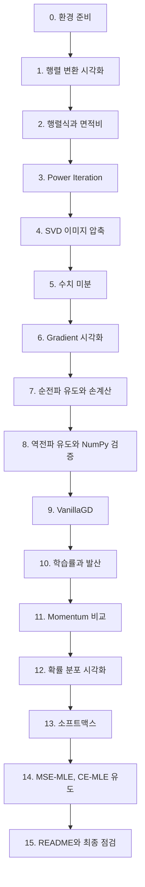

# A2-1 단계별 실습 가이드 — NumPy로 AI 학습의 수학 직접 구현하기

이 문서는 [A2-1 과제](../subject.md)를 환경 준비부터 제출까지 순서대로 진행하기 위한 안내서다. 각 단계는 **목표 / 할 일 / 힌트 / 확인 방법**으로 구성된다. 완성 코드는 없다. 개념이 막히면 [개념 정리](LEARNING_GUIDE.md)의 해당 절을 먼저 읽는다.

> 표기 규칙: subject.md에 없는 제안은 **(권장)**으로 표시한다. subject.md의 결과 예시와 실제 계산이 다른 부분은 **(주의)**로 표시했다.

## 최종 결과물 구조

```text
A2-1/
├── src/
│   ├── linear_algebra.py           # 행렬 변환 시각화, Power Iteration, SVD 압축/복원
│   ├── calculus.py                 # 중심차분 수치 미분, Gradient 시각화
│   └── optimizer.py                # VanillaGD, Momentum 클래스, 수렴 경로 시각화
├── notebooks/
│   ├── backprop_derivation.ipynb   # 2층 신경망 순전파/역전파 유도, 손계산, NumPy 검증
│   └── probability_loss.ipynb      # 분포 시각화, 소프트맥스, MSE-MLE, CE-MLE
├── outputs/                        # 모든 시각화 PNG
├── data/                           # (권장) SVD용 흑백 이미지
├── requirements.txt                # 라이브러리와 버전
└── README.md                       # 개요, 실행 방법, 주요 결과 요약
```

요구사항 4-1(선형대수), 4-2(미적분), 4-4(최적화)의 "확인한다" 항목은 모듈 함수를 호출해 결과를 출력하는 곳이 필요하다. 어디서 실행할지는 subject.md에 정해져 있지 않으므로, 각 모듈의 `if __name__ == "__main__":` 블록이나 (권장) 별도 데모 노트북 중 하나를 골라 README 실행 방법에 적는다.

## 진행 지도



5~6단계(미분)를 마친 뒤 7~8단계(역전파)로 가는 순서를 지킨다. 9~11단계(최적화)는 6단계의 Gradient 개념을 그대로 쓴다.

---

## 0단계. 환경 준비

**목표**: 허용 라이브러리만 있는 재현 가능한 환경을 만든다.

**할 일**

1. Python 3.8 이상 확인, 가상환경 생성.
2. NumPy, Matplotlib, Seaborn, Jupyter 설치.
3. 위 폴더 구조와 `outputs/` 폴더를 만든다.
4. `requirements.txt`에 라이브러리와 버전을 적는다(필수).

**힌트**

```text
# requirements.txt 형식 예시 (버전은 실제 설치 버전 확인 후 작성)
numpy>=1.21
matplotlib>=3.4
```

- `pip show numpy`로 설치 버전을 확인한다. Seaborn을 쓰면 함께 적는다. Jupyter를 적을지는 선택이다.
- 랜덤을 쓰는 곳(Power Iteration 시작 벡터 등)에는 `np.random.seed(42)`를 둔다.
- (권장) 저장 경로는 `pathlib.Path`로 만들고, 저장 전에 `outputs/` 폴더가 있는지 확인한다.

**확인 방법**: `python -c "import numpy, matplotlib; print(numpy.__version__, matplotlib.__version__)"`가 권장 버전 이상을 출력한다.

---

## 1단계. 행렬 변환 시각화 (`src/linear_algebra.py`)

**목표**: 단위 원에 회전·스케일링·전단 행렬을 적용하고, 변환 전후를 한 Figure에 겹쳐 그린다(요구사항 4-1 1~3번).

**할 일**

1. 회전 R(θ), 스케일링 S(sx, sy), 전단 Sh(k) 행렬을 만드는 함수를 작성한다.
2. 단위 원 점 집합을 만든다(`theta = np.linspace(0, 2*np.pi, 100)`).
3. 행렬과 점 집합을 받아 변환 전후를 겹쳐 그리고 PNG로 저장하는 시각화 함수를 작성한다.
4. R(θ)(θ는 직접 선택), S(2, 0.5), Sh(k)(k는 직접 선택) 각각에 대해 그림을 만든다.

**힌트**

```python
def plot_transformation(matrix, points, title, save_path):
    """변환 전후 점 집합을 한 Figure에 겹쳐 그린다. points: (2, N)"""
    pass
```

- 점 배열을 `(2, N)`으로 두면 `matrix @ points` 한 줄로 변환된다([개념 정리 2절](LEARNING_GUIDE.md#2-선형-변환-행렬은-공간을-바꾸는-기계)).
- `ax.set_aspect('equal')`로 축 비율을 맞춘다. 안 그러면 원이 원처럼 안 보인다.
- 변환 전/후 색과 범례를 다르게 하면 결과 예시처럼 읽기 쉽다.
- 회전은 원이 원으로 남아서 변화가 안 보일 수 있다. (권장) 원 위의 한 점(예: 각도 0의 점)이나 기준 화살표를 함께 표시하면 회전이 눈에 보인다.

**확인 방법**

- S(2, 0.5) 결과의 x 범위가 약 [-2, 2], y 범위가 약 [-0.5, 0.5]다.
- Sh(k) 결과에서 (0, 1) 점이 (k, 1)로 이동했다.
- `outputs/`에 PNG 3개가 생겼다.

---

## 2단계. 행렬식과 면적비 (1% 검증)

**목표**: det(A)와 변환 후 면적 비율을 비교해 오차 1% 이내를 확인한다(요구사항 4-1 4번).

**할 일**

1. 2×2 행렬식을 계산한다(`np.linalg.det` 또는 ad - bc 직접 계산).
2. 점 집합으로 만든 다각형 면적을 계산하는 함수를 작성한다(신발끈 공식).
3. 면적비 = 변환 후 면적 / 변환 전 면적을 구하고, det와의 상대 오차(%)를 출력한다.

**힌트**

- 신발끈 공식에서 "다음 점"은 `np.roll(x, -1)`로 만든다([개념 정리 3절](LEARNING_GUIDE.md#3-행렬식det과-면적)).
- `linspace(0, 2π, 100)`은 시작점과 끝점이 같은 점이다. 신발끈 공식에서는 길이 0인 변이 하나 생길 뿐 결과에 영향이 없다.
- 과제의 세 변환은 모두 det = 1이다. (권장) det ≠ 1인 행렬(예: S(2, 3), det = 6)로도 검증하면 함수가 정말 면적 변화를 잡는지 확인할 수 있다.
- 결과 출력 형식은 subject.md 8절 예시("det(S) = 1.0, 면적비 = 1.0, 오차 = 0%")를 참고한다.

**확인 방법**

- 단위 정사각형 꼭짓점 4개를 넣으면 면적 1이 나온다(함수 단위 테스트).
- 세 변환 모두 오차 < 1%가 출력된다.

---

## 3단계. Power Iteration (5% 검증)

**목표**: 최대 고유값과 고유벡터를 Power Iteration으로 직접 계산하고, `np.linalg.eig`와 비교한다(결과물 1, 요구사항 4-1 5~6번).

**할 일**

1. `power_iteration(A, num_iter, tol)` 형태의 함수를 작성한다. 반환: 고유값, 고유벡터, 실제 반복 횟수.
2. 별도의 검증 코드에서 `np.linalg.eig`를 호출해 최대 고유값을 고르고 비교한다.
3. 상대 오차(%)를 출력하고 5% 이내인지 확인한다.

**힌트**

```python
def power_iteration(A, num_iter=1000, tol=1e-6):
    """Power Iteration으로 최대 고유값과 고유벡터를 구한다.
    수식: v_{k+1} = A v_k / ||A v_k||,  λ ≈ v^T A v
    """
    pass
```

- 알고리즘은 [개념 정리 4.2절](LEARNING_GUIDE.md#42-power-iteration) 참고. 시작 벡터는 시드 고정 후 랜덤으로 만든다.
- **`np.linalg.eig`는 `power_iteration` 함수 안에서 쓰면 안 된다.** 검증 전용이다(제약 사항).
- `eig`의 고유값은 정렬되어 있지 않다. 최댓값 인덱스를 찾고, 고유벡터는 `vecs[:, i]`(열)로 꺼낸다.
- 고유벡터 부호가 반대일 수 있다. 비교 전에 부호를 맞춘다.

**확인 방법**

- subject.md 예시 행렬 [[4, 1], [1, 3]]에서 λ ≈ 4.6180, v ≈ ±[0.8507, 0.5257]이 나온다.
- 개념 정리의 손계산 예제 [[2, 1], [1, 2]]에서 λ ≈ 3이 나온다.
- (권장) 3×3 대칭 행렬 등 다른 행렬로도 시험해 본다.

---

## 4단계. SVD 이미지 압축/복원

**목표**: 흑백 이미지를 SVD로 압축하고 k = 10, 50, 100 복원 결과를 한 Figure에 비교한다(결과물 1, 요구사항 4-1 7번).

**할 일**

1. 64×64 이하 흑백 이미지를 준비한다(직접 촬영 또는 공개 이미지).
2. 이미지 행렬과 k를 받아 랭크 k 근사를 돌려주는 함수를 작성한다.
3. 원본과 k = 10, 50, 100 복원 결과를 subplot으로 나란히 그리고 저장한다.

**힌트**

- 이미지 읽기는 `matplotlib.pyplot.imread`를 쓴다(PNG는 0~1 실수 배열). 컬러면 채널 가중합 등으로 2차원 흑백으로 만든다. 64×64보다 크면 슬라이싱(`img[::n, ::n]`)으로 줄일 수 있다.
- `np.linalg.svd(img, full_matrices=False)`가 편하다. `s`는 1차원 배열이다.
- **(주의)** 64×64 이미지의 특이값은 최대 64개다. k = 100은 성분 수보다 크므로 `min(k, len(s))`로 제한하고, 그림 제목이나 설명에 실제 사용한 k를 적는다([개념 정리 5.2절](LEARNING_GUIDE.md#52-저랭크-근사rank-k-approximation)). k = 50, 100이 원본과 거의 같게 보이는 것은 정상이다.
- (권장) 각 k의 저장량 비율 k(m+n+1)/(mn)과 복원 오차(예: 원본과의 평균 제곱 오차)를 함께 출력하면 "압축"의 의미가 분명해진다.
- `imshow`에 `cmap='gray'`와 같은 `vmin`, `vmax`를 주어 모든 칸의 밝기 기준을 같게 한다.

**확인 방법**

- k가 커질수록 복원 오차가 줄어든다.
- k = 특이값 개수일 때 원본과의 오차가 거의 0(1e-10 수준)이다.
- 원본 포함 4칸 Figure가 `outputs/`에 저장되었다.

---

## 5단계. 수치 미분 (`src/calculus.py`)

**목표**: 중심차분 기반 수치 미분 함수를 만들고, f(x) = x²의 x = 3에서 해석값 6과 오차 1e-4 이내를 확인한다(결과물 2, 요구사항 4-2 1번).

**할 일**

1. 1변수 중심차분 함수를 작성한다(Docstring에 수식 포함).
2. (권장) 2변수 함수의 각 편미분을 중심차분으로 구하는 함수도 작성한다. 6단계 Gradient 검증에 쓸 수 있다.
3. x = 3에서 결과와 오차를 출력한다.

**힌트**

- 공식: (f(x+h) - f(x-h)) / (2h) ([개념 정리 6.2절](LEARNING_GUIDE.md#62-수치-미분-전방차분-vs-중심차분)).
- h 기본값은 1e-5 정도가 무난하다.
- (권장) h를 1e-1부터 1e-12까지 바꿔 가며 오차를 로그 스케일로 그려 보면 "h가 너무 작으면 오히려 오차가 커지는" 현상을 직접 볼 수 있다. f = x²는 중심차분 오차가 거의 0이라 f = x³ 같은 함수가 이 실험에 더 적합하다.

**확인 방법**: `abs(결과 - 6) < 1e-4`가 `True`다.

---

## 6단계. Gradient 시각화

**목표**: f(x, y) = x² + y²의 등고선 위에 여러 점의 Gradient 화살표를 그리고, 등고선에 수직임을 확인한다(결과물 2, 요구사항 4-2 2~4번).

**할 일**

1. `np.meshgrid`로 격자를 만들고 Z = f(X, Y)를 계산한다.
2. `contour`로 등고선을 그린다.
3. 더 성긴 격자(또는 선택한 점들)에서 Gradient를 계산하고 `quiver`로 화살표를 그린다.
4. 저장한다.

**힌트**

- Gradient는 해석식 (2x, 2y)로 구해도 되고, 5단계의 수치 미분으로 구해도 된다. 둘을 비교하면 검증이 된다.
- **`ax.set_aspect('equal')` 필수.** 축척이 다르면 수직이 수직으로 보이지 않는다([개념 정리 7.3절](LEARNING_GUIDE.md#73-왜-gradient는-등고선에-수직인가)).
- 원점 근처 화살표는 매우 짧고 바깥은 길다. `quiver`의 `scale` 인자나 방향만 보이게 정규화하는 방법을 고려한다.
- (권장) 몇몇 점에서 Gradient와 접선 방향의 내적이 0에 가까운지 출력하면 "시각적 확인"을 수치로 보강할 수 있다.

**확인 방법**: 화살표가 모두 원점에서 바깥 방향으로 뻗고, 원형 등고선과 직각으로 만난다.

---

## 7단계. 순전파 유도와 손계산 (`notebooks/backprop_derivation.ipynb`)

**목표**: 2층 신경망(2 → 2 → 1)의 순전파 수식을 쓰고, 고정 예제로 z1, a1, z2, y_pred를 손계산한다(요구사항 4-3).

**할 일**

1. 노트북 첫 부분에 네트워크 구조, 표기법, 행렬 곱 규약(`z1 = W1 @ x`)을 마크다운으로 쓴다.
2. 순전파 수식을 일반형으로 쓴다(z1, a1, z2, y_pred, L).
3. 고정 값을 대입해 단계별로 손계산한다. 각 값 옆에 shape을 쓴다.

| 항목 | 고정 값 (subject.md) |
| --- | --- |
| x | [1, 0] |
| W1 | [[0.1, 0.2], [0.3, 0.4]] |
| b1 | [0, 0] |
| W2 | [0.5, 0.6] |
| b2 | 0 |
| 활성화 | Sigmoid |
| 손실 | BCE: L = -(y·log(ŷ) + (1-y)·log(1-ŷ)) |
| y_true | **(주의)** subject.md 본문에는 값이 비어 있다. 결과 예시는 y_true = 1을 사용한다. 사용한 값을 노트북에 명시한다. |

**힌트**

- 손계산이란 "식 → 숫자 대입 → 결과"를 모두 적는 것이다. 지수 계산은 계산기를 써도 되지만 과정은 남긴다.
- shape 표기 예: `z1: (2,)`, `W1: (2,2)`, `z2: scalar`.
- 중간값은 6자리 이상 유지한다. 4자리로 일찍 반올림하면 8단계 비교에서 마지막 자리가 어긋날 수 있다.

**확인 방법**: z1 = [0.1, 0.3]이 나오고, subject.md 8절의 순전파 예시 값과 같은 값이 나온다.

---

## 8단계. 역전파 유도와 NumPy 검증

**목표**: 연쇄 법칙으로 ∂L/∂y_pred, ∂L/∂z2, ∂L/∂W2, ∂L/∂a1, ∂L/∂z1, ∂L/∂W1을 모두 유도하고 손계산한 뒤, NumPy로 같은 계산을 해서 소수점 4자리까지 일치함을 확인한다(요구사항 4-3).

**할 일**

1. 각 기울기를 **일반 수식 → 연쇄 법칙 분해 → 숫자 대입 → shape** 순서로 쓴다.
2. 두 체크포인트(∂L/∂z2, ∂L/∂z1)에서 멈추고 값을 점검한다.
3. NumPy 셀에서 같은 순전파·역전파를 계산한다.
4. 손계산 값을 배열로 적어 두고 NumPy 결과와 비교한다.

**힌트**

- 일반 규칙(외적, 전치 곱, 원소별 곱)은 [개념 정리 11.4절](LEARNING_GUIDE.md#114-층을-거슬러-올라가는-일반-규칙)에 있다. 이 과제에서 W2는 (2,) 벡터라 출력층은 스칼라 × 벡터가 된다.
- ∂L/∂z2는 y_pred - y_true로 간단해진다. 왜 그런지 유도 과정을 노트북에 쓴다([개념 정리 11.3절](LEARNING_GUIDE.md#113-시그모이드--bce의-깔끔한-결과)).
- σ'(z1)은 a1 * (1 - a1)로 계산한다.
- 비교는 `np.round(값, 4)`끼리 비교하거나 `np.allclose(손계산, numpy결과, atol=5e-5)`를 쓴다.
- **(주의)** subject.md 결과 예시의 ∂L/∂z1 두 번째 원소(-0.0513)는 다시 계산하면 소수 넷째 자리가 다르게 나온다. 예시가 아니라 **내 손계산과 NumPy 결과의 일치**가 기준이다. 다른 값들은 예시와 일치하는지 체크포인트로 써도 된다.
- (권장) 6단계의 수치 미분으로 W1, W2의 각 원소를 조금씩 움직여 손실 변화로 기울기를 근사하면(gradient checking) 유도 결과를 세 번째 방법으로 검증할 수 있다.

**확인 방법**

- 모든 기울기의 shape이 해당 변수의 shape과 같다(∂L/∂W1: (2, 2), ∂L/∂a1: (2,) 등).
- x의 두 번째 원소가 0이므로 ∂L/∂W1의 두 번째 열이 0이다. 왜 그런지 설명할 수 있다.
- NumPy 결과와 손계산이 소수점 4자리까지 일치한다는 출력이 노트북에 남아 있다.

---

## 9단계. VanillaGD (`src/optimizer.py`)

**목표**: Vanilla GD 클래스를 구현해 f(x, y) = x² + y²에 적용하고, lr = 0.1로 100회 후 원점 반경 0.1 이내 도달을 확인한다. 수렴 경로를 등고선 위에 점선으로 그린다(결과물 4, 요구사항 4-4 1~3번).

**할 일**

1. 옵티마이저 클래스를 설계한다. 학습률을 생성자에서 받고, 현재 위치와 Gradient를 받아 다음 위치를 돌려주는 `step` 메서드를 둔다.
2. 시작점, 반복 횟수를 받아 경로(모든 위치 기록)를 돌려주는 실행 함수를 만든다.
3. 등고선 위에 경로를 점선으로 그리는 시각화 함수를 만든다.

**힌트**

```python
class VanillaGD:
    """경사하강법. 수식: θ ← θ - lr * ∇f(θ)"""
    def __init__(self, lr=0.1):
        pass
    def step(self, params, grads):
        pass
```

- 경로는 리스트에 쌓았다가 마지막에 `np.array`로 바꾸면 shape `(n_iter+1, 2)`가 된다.
- 점선: `ax.plot(path[:, 0], path[:, 1], linestyle='--', marker='o')`.
- 시작점은 자유다. subject.md 예시는 (5, 5)를 쓴다.
- 최종 위치의 원점 거리는 `np.linalg.norm(path[-1])`.

**확인 방법**

- lr = 0.1, 100회 후 거리 < 0.1이 출력된다(손계산상 5·0.8¹⁰⁰ 수준이라 매우 작다. [개념 정리 8.2절](LEARNING_GUIDE.md#8-경사하강법gradient-descent과-학습률)).
- 경로가 등고선 그림 위에 점선으로 표시된 PNG가 저장되었다.

---

## 10단계. 학습률과 발산

**목표**: lr = 0.5 이상에서 최적화 경로가 발산함을 그래프로 보인다(요구사항 4-4 4번).

**할 일**

1. 여러 학습률로 실행해 거리(또는 함숫값)를 반복 횟수에 따라 그린다.
2. 발산하는 경우를 그래프로 보이고, 왜 그런지 설명을 붙인다.

**힌트**

- **(주의)** f = x² + y²에서 각 좌표는 매 걸음 (1 - 2·lr)배가 된다. lr = 0.5면 한 걸음에 원점, lr = 1.0이면 진동, **lr > 1.0이어야 발산**한다([개념 정리 8.2~8.3절](LEARNING_GUIDE.md#8-경사하강법gradient-descent과-학습률)). 요구사항("0.5 이상")을 충족하면서 실제로 발산을 보이려면 다음 중 하나를 택하고, 그 이유를 적는다.
  - f = x² + y²에서 lr > 1.0(예: 1.05, 1.1) 사용
  - 타원형 f = x² + 10y²에서 lr = 0.5 사용(y 방향 배율 -9)
- 발산 경로는 값이 폭발해 등고선 그림 범위를 벗어난다. 반복 횟수를 적게(예: 10회) 하거나, 거리-반복 그래프의 y축을 로그 스케일로 그리면 잘 보인다.
- (권장) lr = 0.1, 0.5, 0.9, 1.0, 1.1을 한 그래프에 그리면 "수렴 → 한 번에 도달 → 진동 수렴 → 진동 → 발산"이 한눈에 보인다.

**확인 방법**: 발산 경우의 그래프가 저장되었고, 거리가 반복할수록 커진다.

---

## 11단계. Momentum과 비교

**목표**: Momentum(β = 0.9)을 구현하고, Vanilla GD와 수렴 경로를 한 Figure에 겹쳐 비교한다. 타원형 함수 f = x² + 10y²에서 Momentum의 이점을 확인한다(결과물 4, 요구사항 4-4 5~7번).

**할 일**

1. `Momentum` 클래스: lr, beta를 받고, 속도 v를 상태로 기억한다.
2. 같은 시작점·같은 lr로 두 옵티마이저를 실행해 경로를 한 등고선 그림에 겹쳐 그린다(f = x² + y²).
3. f = x² + 10y²에서도 같은 비교를 한다.
4. 비교 지표를 정해 수치로 출력하고 해석을 쓴다.

**힌트**

- 수식: v ← βv + ∇f, θ ← θ - lr·v ([개념 정리 9절](LEARNING_GUIDE.md#9-momentum)). 속도 v는 첫 `step`에서 0으로 시작한다. 같은 객체를 다른 실험에 재사용하면 이전 속도가 남아 있으니 주의한다.
- Gradient 함수를 인자로 받게 만들면 두 테스트 함수에 같은 코드를 쓸 수 있다.
- **(주의)** 실험 조건에 따라 결과가 예시와 다를 수 있다.
  - f = x² + y², lr = 0.1: Momentum은 반경 0.1에 **먼저 들어오지만** 나선형으로 돌아서 100회째 위치는 Vanilla보다 원점에서 멀 수 있다.
  - f = x² + 10y²: lr이 작을 때(예: 0.01~0.02) Momentum의 이점이 뚜렷하다. subject.md 예시의 lr = 0.05는 y 방향 배율이 정확히 0이 되는 특수한 값이라 Vanilla가 오히려 빨라 보일 수 있다. 지그재그를 보고 싶다면 lr을 0.05보다 조금 크게(0.1 미만) 잡아 본다.
- 그래서 비교 지표를 명확히 하는 것이 중요하다. 예: "반경 0.1 안에 처음 들어온 반복 수", "N회 후 거리", "반복별 f 값 곡선". 여러 lr로 표를 만들어 보면 설명이 탄탄해진다(권장).

**확인 방법**

- 두 경로가 한 Figure에 범례와 함께 겹쳐 그려졌다(두 함수 모두).
- 타원형 함수에서 Momentum이 유리한 조건을 수치로 보여 주는 출력이나 표가 있다.
- 해석에 "왜 그런가"(완만한 방향 가속, 지그재그 상쇄)가 들어 있다.

---

## 12단계. 확률 분포 시각화 (`notebooks/probability_loss.ipynb`)

**목표**: 정규분포 PDF 2종과 베르누이 PMF 2종을 각각 한 Figure에 비교한다(결과물 5, 요구사항 4-5 1~2번).

**할 일**

1. 정규분포 PDF를 NumPy로 직접 구현한다(공식 사용).
2. N(0, 1)과 N(2, 0.5)를 한 Figure에 그린다.
3. 베르누이 PMF를 구현하고 B(0.3), B(0.7)을 한 Figure에 막대그래프로 그린다.
4. 각 그림을 `outputs/`에 저장하고 해석을 쓴다.

**힌트**

- PDF 공식은 [개념 정리 12.2절](LEARNING_GUIDE.md#12-확률-분포-pmf와-pdf). 계산은 NumPy로 한다(제약 사항: Matplotlib/Seaborn은 시각화에만).
- **(주의)** N(2, 0.5)의 0.5가 분산인지 표준편차인지 subject.md에 명시가 없다. 관례 N(μ, σ²)이면 분산 0.5다. 어느 쪽으로 해석했는지 마크다운에 적는다.
- 베르누이 두 분포의 막대가 겹치지 않도록 x 위치를 조금씩 이동하고 `width`를 줄인다.
- (권장) PDF 곡선 아래 넓이를 `np.trapz`(NumPy 2.x에서는 `np.trapezoid`)로 계산해 약 1인지 확인한다.

**확인 방법**: N(0, 1) 최고점이 약 0.399이다. PMF 막대 두 개의 합이 각 분포마다 1이다.

---

## 13단계. 소프트맥스

**목표**: 소프트맥스를 구현하고 출력 합과 1.0의 차이가 1e-6 이내임을 확인한다(요구사항 4-5 3번).

**할 일**

1. 수치 안정성을 고려한 소프트맥스 함수를 작성한다(Docstring에 수식).
2. 여러 입력으로 합을 검증한다.

**힌트**

- 최댓값을 빼는 이유는 [개념 정리 13절](LEARNING_GUIDE.md#13-소프트맥스). z = [1000, 1001, 1002] 같은 큰 입력으로 시험해 `nan`이 안 나오는지 본다.
- 손계산 예: [1, 2, 3] → 약 [0.0900, 0.2447, 0.6652].

**확인 방법**: 모든 테스트 입력에서 `abs(sum - 1.0) < 1e-6`이 `True`이고, 큰 입력에서도 `nan`이 없다.

---

## 14단계. MSE-MLE, CE-MLE 유도

**목표**: "MSE 최소화 = 정규분포 가정 하의 MLE", "Cross-Entropy 최소화 = 베르누이/카테고리 분포 가정 하의 MLE"를 수식으로 유도해 노트북에 쓴다(요구사항 4-5 4~5번).

**할 일**

1. MLE의 정의(우도 → 로그 우도 → 음의 로그 우도)를 먼저 쓴다.
2. MSE 유도: 가정(y = f(x) + ε, ε ~ N(0, σ²)) → p(y|x) → 로그 → 상수 제거 → MSE.
3. CE 유도: 베르누이 가정 → p(y|x) = ŷ^y(1-ŷ)^(1-y) → -log → BCE. 그리고 카테고리 분포로 확장.
4. 결론과 "언제 어떤 손실을 쓰는가"를 정리한다.

**힌트**

- subject.md 8절에 MSE 유도 예시가 있다. 그대로 옮기기보다 각 등호에서 **무엇을 제거했고 왜 제거해도 되는지**를 문장으로 덧붙인다.
- CE의 카테고리 확장은 원-핫 정답 벡터 때문에 정답 클래스 항 하나만 남는다는 점이 핵심이다([개념 정리 14.3절](LEARNING_GUIDE.md#143-cross-entropy--베르누이카테고리-분포-가정의-mle)).
- 노트북 마크다운에서 `$...$`, `$$...$$` LaTeX 수식을 쓸 수 있다.
- (권장) 동전 예제(10번 중 7번 앞면 → p = 0.7)를 NumPy로 p를 0.01 간격으로 바꿔 가며 로그 우도를 그려 보면 MLE가 눈에 보인다.

**확인 방법**: 두 유도 모두 "가정 → 우도 → 로그 → 정리 → 결론" 단계가 빠짐없이 있다.

---

## 15단계. README와 최종 점검

**목표**: README를 완성하고 모든 요구사항을 점검한 뒤 저장소 URL을 제출한다.

**할 일**

1. README에 프로젝트 개요, 실행 방법(설치, 각 모듈/노트북 실행 순서, 출력 위치), 주요 결과 요약을 쓴다.
2. 주요 결과 요약에는 각 검증의 수치(오차 %, 고유값, 수치 미분 오차, 최종 거리 등)와 대표 그림(`outputs/` PNG 링크)을 넣는다.
3. 노트북은 커널 재시작 후 전체 실행으로 오류가 없음을 확인하고, 출력이 남은 상태로 저장한다.

| subject.md 요구사항 | 어디서 확인하는지 |
| --- | --- |
| 결과물 1 `src/linear_algebra.py` (변환 시각화, Power Iteration, SVD) | 파일 내 세 기능 함수 |
| 결과물 2 `src/calculus.py` (중심차분, Gradient 시각화) | 파일 내 두 함수 |
| 결과물 3 `notebooks/backprop_derivation.ipynb` | 유도, 손계산(체크포인트, shape), NumPy 검증 셀 |
| 결과물 4 `src/optimizer.py` (VanillaGD, Momentum, 경로 시각화) | 두 클래스와 시각화 함수 |
| 결과물 5 `notebooks/probability_loss.ipynb` | 분포 그림, 소프트맥스, 두 유도 |
| 결과물 6 README (개요, 실행 방법, 결과 요약) | README 목차 |
| 4-1 회전·스케일링·전단, 전후 겹침 | `outputs/` PNG 3개 |
| 4-1 det vs 면적비 1% 이내 | 2단계 출력 |
| 4-1 Power Iteration vs eig 5% 이내 | 3단계 출력 |
| 4-1 SVD k = 10, 50, 100 한 Figure | 4단계 PNG |
| 4-2 f'(3) 오차 1e-4 이내 | 5단계 출력 |
| 4-2 등고선 + Gradient 화살표 + 수직 | 6단계 PNG |
| 4-3 순전파 수식, 역전파 단계별 유도 | backprop 노트북 마크다운 |
| 4-3 z1, a1, z2, y_pred 기록, 6개 기울기, shape 표기 | backprop 노트북 손계산 표 |
| 4-3 NumPy와 소수점 4자리 일치 | backprop 노트북 검증 셀 출력 |
| 4-4 lr = 0.1, 100회 후 반경 0.1 이내, 점선 경로 | 9단계 출력과 PNG |
| 4-4 lr ≥ 0.5 발산 그래프 | 10단계 PNG |
| 4-4 Momentum(β = 0.9), 두 경로 한 Figure, 타원형 비교 | 11단계 PNG와 해석 |
| 4-5 N(0,1), N(2,0.5) PDF 한 Figure / B(0.3), B(0.7) PMF 한 Figure | probability 노트북, PNG |
| 4-5 소프트맥스 합 1e-6 이내 | probability 노트북 출력 |
| 4-5 MSE-MLE, CE-MLE 유도 | probability 노트북 마크다운 |
| 6 `np.random.seed(42)`, PNG는 `outputs/` | 코드 검색, 폴더 확인 |
| 7 `linalg.eig`는 검증에서만 | `eig` 호출 위치 검색 |
| 7 자동 미분 라이브러리, sklearn PCA/최적화 미사용 | import 검색 |
| 7 모든 클래스·함수 Docstring, 수식 명시 | 각 `def`/`class` 아래 확인 |
| 7 requirements.txt 버전 명시 | 파일 확인 |

점검용 명령 예시:

```bash
grep -rnE "import (torch|tensorflow|jax|sklearn)|from (torch|tensorflow|jax|sklearn)" src notebooks
grep -rn "linalg.eig" src notebooks        # 검증 코드에만 있어야 함
grep -rn "random.seed" src notebooks
```

---

## 자주 하는 실수 모음

| 증상 | 원인 | 해결 |
| --- | --- | --- |
| 원이 타원으로 보임, 화살표가 수직이 아님 | 축 비율 불일치 | `ax.set_aspect('equal')` |
| 변환 결과가 이상하게 기울어짐 | `(N, 2)` 점 배열에 `points @ A` | `(2, N)`에 `A @ points`, 또는 `points @ A.T` |
| Power Iteration 고유벡터 부호가 eig와 반대 | 고유벡터는 부호 자유 | 부호 맞춘 뒤 비교 |
| eig 비교 시 엉뚱한 값 | eig 결과 미정렬, 행/열 혼동 | 최댓값 인덱스, `vecs[:, i]` |
| SVD 복원 shape 오류 | `s`를 행렬로 착각, `full_matrices=True` | `np.diag(s[:k])`, `full_matrices=False` |
| k = 100에서 인덱스 문제 또는 혼란 | 64×64의 랭크는 최대 64 | `min(k, len(s))`, 설명 추가 |
| 손계산과 NumPy가 4번째 자리에서 다름 | 중간값 조기 반올림 | 6자리 이상 유지 후 마지막에 반올림 |
| ∂L/∂W1이 전치되어 나옴 | 순전파 규약과 외적 순서 불일치 | `W1 @ x`면 `outer(δ, x)` |
| Momentum 결과가 실행할 때마다 다름 | 속도 v가 이전 실험에서 남음 | 실험마다 새 객체 생성 또는 reset |
| 발산 그래프가 안 보임 | 값 폭발로 축 범위 초과 | 반복 수 줄이기, 로그 스케일 |
| 소프트맥스가 `nan` | 큰 입력에서 overflow | 최댓값 빼기 |
| 노트북에서 `src` import 실패 | 노트북 위치가 `notebooks/` | `sys.path.append("..")` |

---

## 보너스 과제 (선택)

본 과제를 모두 끝낸 뒤 시도한다. 힌트만 제공한다. 개념 요약은 [개념 정리 부록](LEARNING_GUIDE.md#부록-보너스-개념-미리보기)에 있다.

### 보너스 1. Adam

- 기존 `optimizer.py`의 인터페이스(`step(params, grads)`)를 그대로 따르는 클래스로 만들면 비교 코드를 재사용할 수 있다.
- 상태: 1차 모멘트 m, 2차 모멘트 v, 반복 횟수 t. 편향 보정에 t가 필요하다.
- 흔히 쓰는 기본값은 β₁ = 0.9, β₂ = 0.999, ε = 1e-8이다. Adam은 lr의 감각이 GD와 다르므로 여러 lr로 시험한다.
- 비교: 세 옵티마이저(Vanilla, Momentum, Adam)의 "반복별 f 값"을 한 그래프에, 특히 타원형 함수에서 비교한다.

### 보너스 2. Newton Method

- 갱신식: θ ← θ - H⁻¹∇f. 2×2 Hessian의 역행렬 대신 `np.linalg.solve(H, grad)`를 쓰는 것이 수치적으로 낫다.
- 2차 함수에서 몇 번 만에 수렴하는지 먼저 예측해 보고 실험으로 확인한다.
- 장단점 정리 포인트: 수렴 속도, Hessian 계산 비용(차원 d이면 d×d), Hessian이 양의 정부호가 아닐 때의 문제.

### 보너스 3. 정보 이론

- 엔트로피, KL-Divergence, Cross-Entropy를 NumPy로 구현하고 H(p, q) = H(p) + D_KL(p‖q)가 수치로 성립하는지 확인한다.
- log(0) 처리 방법(0·log 0 = 0 관례, 작은 ε 추가)을 정하고 Docstring에 적는다.
- D_KL(p‖q) ≠ D_KL(q‖p)임을 예제로 보이면 비대칭성을 이해했다는 증거가 된다.
